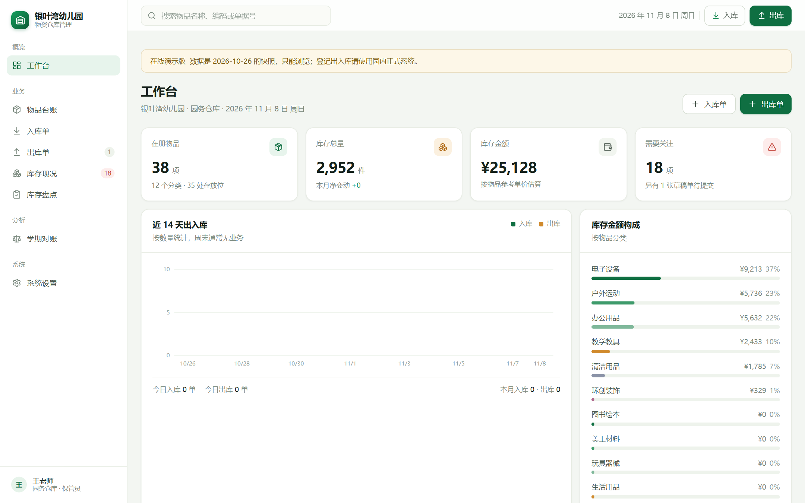

# 银叶湾幼儿园 · 物资仓库（在线演示）

幼儿园小仓库的台账系统演示版：物品台账、入库、出库、库存、盘点、学期对账。
**这个仓库只是只读演示**：数据是 2026-10-26 的快照，所有录入按钮已移除。

> 在线预览：<https://qf331816.github.io/yinyewan-warehouse/>



## 它是什么

给幼儿园总务/保管老师用的一套轻量系统，解决五件事：

- 东西有哪些、放在哪个区
- 进了什么（入库单，含供应商）
- 谁领走了（出库单，含班级/用途）
- 还剩多少（库存 + 安全库存预警）
- 期末怎么对账（期初 + 入 − 出 = 期末，可导出 CSV）

## 关于这个仓库

线上版本是用 `next build` 的静态导出（`output: "export"`）生成的纯静态站点，
放在 GitHub Pages 上，任何人打开链接就能看，手机上也能用。

真实使用的版本是一个本地运行的完整系统（带数据库、可录入、有独立的数据维护后台），
不在此仓库中。本仓库仅用于给同事、家长委员会或同行**看界面和流程**。

## 本地运行（只想看效果）

```bash
npm install
npx next build          # 生成 out/
npx serve out           # 或者任意静态服务器
```

如果要带仓库名路径（模拟 GitHub Pages），构建前设置：

```bash
# Windows PowerShell
$env:NEXT_PUBLIC_BASE_PATH="/yinyewan-warehouse"; npx next build
# macOS / Linux
NEXT_PUBLIC_BASE_PATH=/yinyewan-warehouse npx next build
```

## 技术栈

- Next.js 16（App Router，静态导出）
- React 19 + TypeScript
- Tailwind CSS 4 + 自建设计系统（绿色主题）
- 数据：构建时打包的 JSON 快照（`db/demo.json`），纯前端读取

## 说明

- 演示数据已脱敏：人名、供应商名均为虚构，不含任何真实账号或联系方式
- 界面里的「数据维护」系统不在本仓库内
